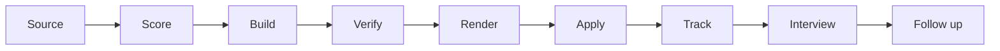

# AB.Agentic Job Search

[](https://github.com/andreybuilt/agentic-job-search/actions)


`agentic-job-search` is a toolkit for running a job search with Claude Code or Codex. It sources
postings, builds application packets from one facts file, and runs them through gates that
refuse a resume or cover letter making a claim your facts don't support.

**Who it's for:** someone comfortable in a terminal who wants AI help with the mechanical parts
of a job search (sourcing, drafting, anti-fabrication checks, tracking) and will read and edit
Markdown and YAML. Not a SaaS, and not a bot that applies for you.

**What makes it different:**

- **One facts file.** Every claim traces to `FACTS.md`. `tools/verify/claim_audit.py` runs its own
  controls before it audits, so a broken matcher cannot report a clean pass.
- **Gates that catch fabrication and leaked names.** A missing or empty banned-name list, an
  unreadable PDF, or a resume addressed to the wrong company is a refusal, not a pass
  (`tools/verify/`, `tools/build/render-resume_v3.sh`).
- **The human keeps every irreversible click.** The safety contract, identical in `CLAUDE.md`,
  `AGENTS.md` and `docs/MULTI_AGENT.md`:

  > The final submit is the human's. Either the human clicks it, or, after reviewing the agent's field-by-field read-back, the human gives an explicit go for THAT ONE submission and the agent clicks. No standing permission. CAPTCHAs, sign-ins, e-signatures, payments: human only, always.

  No tool here submits a job application. The only code that presses a final button books an
  interview slot, and only after a read-back the human has seen:
  `book_link --confirm <code>` is the human's explicit go for that one booking, given after reading the read-back.
  All browser code lives in `tools/build/browser_actions.py`; CI parses every other file under
  `tools/` and fails on a browser import or click (`tests/test_agent_contract.py`). That scan is
  a review aid, not a guarantee.

## See it work in 5 minutes

Offline, no setup, no personal data. Everything runs on the fictional Jordan Rivera fixtures.

```sh
git clone https://github.com/andreybuilt/agentic-job-search
cd agentic-job-search
bash scripts/demo.sh
```

The demo runs five gates and checks that each one behaves:

1. `claim_audit.py`: a truthful packet passes; an inflated one is caught (2 problems).
2. `verify_readback.py`: a cover letter that leaks a banned codename is caught.
3. `check-distinct.py`: two near-copy cover letters are caught; two distinct ones pass.
4. `collision_check.py --controls`: the "have I already applied?" check proves it can fire.
5. `b9_check.py`: the banned-pattern rules prove they fire on a synthetic control.

It ends with `DEMO PASSED: every gate behaved as expected` and exits 0. It needs only Python 3.10+.

## Quick start for real use

```sh
git clone https://github.com/andreybuilt/agentic-job-search
cd agentic-job-search
cp config.example.yaml config.yaml          # replace every Jordan Rivera value with yours
cp templates/FACTS.example.md FACTS.md      # your facts; nothing else may invent a claim
mkdir -p data
cp templates/QUEUE.example.md data/QUEUE.md
touch data/SUBMISSIONS.tsv data/LEDGER_mailbox.tsv data/LEDGER_candidates.tsv
python3 tools/sourcing/build_reqs.py        # writes data/BUILD_reqs.tsv (empty for now)
python3 tools/doctor.py                     # checks Python, config, facts file
python3 tools/doctor.py --stage render      # also checks Chrome, poppler and your font
bash tests/run-all.sh                       # should end with OVERALL: PASS
```

The empty tracker files say "no history yet". `tools/verify/presubmit.sh` treats a missing
tracker as a failure, never as a pass.

Then start your agent in the repo: `claude` (reads `CLAUDE.md`) or `codex` (reads
`AGENTS.md`). Both files hold the same operating rules. Walk through `docs/PIPELINE.md` stage
by stage.

Tools find your config in this order: `--config PATH`, then `$JOBSTACK_CONFIG`, then
`./config.yaml`, then `config.yaml` at the repo root. There is no fallback to the example
file: with no config, a tool stops and tells you to copy it. `config.yaml`, `FACTS.md` and
`data/` are in `.gitignore`.

## The pipeline



Nine stages. `docs/PIPELINE.md` says which tool covers each one, and which stages are templates
or gaps.

| I want to... | Run |
|---|---|
| check my setup | `python3 tools/doctor.py [--stage render]` |
| find open roles on public ATS boards | `python3 tools/sourcing/sweep.py slugs.txt --out-dir data/sweep` |
| freeze a job description into a packet | `python3 tools/build/capture_jd.py <packet> <ats> <token> <req>` |
| check I haven't applied there already | `python3 tools/verify/collision_check.py --employer "Acme Corp" --title "..."` |
| start a packet builder | copy `tools/build/TEMPLATE_build.py`, then run it with `--dry` |
| audit a packet's claims | `python3 tools/verify/claim_audit.py <packet_dir>` |
| scan a batch for leaked names | `python3 tools/verify/verify_readback.py --packets-dir <dir>` |
| compare two cover letters | `python3 tools/build/check-distinct.py a.html b.html` |
| render a resume or letter through the gates | `bash tools/build/render-resume_v3.sh <file.html> "<Company>"` |
| check before a human submits | `bash tools/verify/presubmit.sh <Employer/Slug> <req> --mailbox-hits <n>` |
| record a confirmed send | `python3 tools/verify/record_send.py <spec.json>` |
| list or book an interview slot | `python3 tools/build/book_link.py slots <url>` |

Every tool answers `--help` without a config file and without touching the network.

## What's in here

```text
tools/
  common/config.py     config loader (stdlib-only YAML subset) used by every tool
  sourcing/            public ATS board readers, LinkedIn guest search, JD fetch, build_reqs export
  build/               packetlib + TEMPLATE_build, render pipeline and its gates, capture_jd,
                       check-distinct, book_link (interview self-scheduling)
  verify/              claim_audit, verify_readback, collision_check, b9_check, presubmit,
                       record_send, build_submissions, verify_liveness
  examples/            example rule and list files that config.example.yaml points at
  doctor.py            prerequisite checker
templates/             FACTS, QUEUE, TARGETING, INTERVIEW_TRACKER, call prep, resume and
                       cover-letter HTML, all for the fictional Jordan Rivera
docs/                  PIPELINE, ATS_GOTCHAS, MULTI_AGENT, LESSONS
scripts/demo.sh        the 5-minute offline demo
tests/                 run-all.sh and the unit tests, with fixtures
CLAUDE.md, AGENTS.md   the operating rules for your agent (same text)
config.example.yaml    the complete config schema
```

`docs/LESSONS.md` holds 49 lessons from the search this toolkit came out of, each written as a
claim plus what to do instead.

## What is not included (read this before you expect too much)

- **No reusable scoring engine.** The original stack never built one either: every batch wrote a
  throwaway filter script. `templates/TARGETING.example.md` gives you a rubric template; you
  write or adapt the ranking pass. This is an honest gap, not an oversight.
- **No form-filling automation.** The original implementation drove a browser environment
  specific to its original setup that cannot travel, and a documented incident there (a
  scripted dropdown-select that silently corrupted a live form while reporting success) is the
  worst failure mode in the project's history. Rather than ship a form-fill driver with that
  risk, this repo documents the ATS-specific traps (`docs/ATS_GOTCHAS.md`) and the contract any
  such driver must honor (`CLAUDE.md` rule 7: read back every field, never trust what you
  clicked), and leaves the typing to you or to a form-fill layer you build and test yourself.
- **No mail or calendar integration.** The original mail-watching and interview-filing tools
  were built against one person's private mail setup. Bring your own Gmail API, IMAP, or
  Calendar API client.
- **No CAPTCHA solving, no e-signature, no payment handling.** By design. See `CLAUDE.md`.

## Known bypasses still open

- The anti-fabrication gates (`tools/verify/`) only catch what they're told to look for. A
  banned-name or banned-claim list you never populate catches nothing. They fail closed on a
  *missing* or *empty* list, not on an *incomplete* one.
- The render gates check the rendered PDF text, not its visual layout. A table or section that
  silently overflows a page boundary will not be caught here.
- Nothing in this repo verifies a submission landed beyond what you tell it (an email receipt, a
  portal status). If an employer's system silently drops a submission, this toolkit cannot
  detect that. Treat a missing confirmation as a reason to follow up, not as proof of failure.

## Prerequisites

- **Python 3.10 or newer.** The tools use the standard library only. `requirements.txt` lists
  nothing required.
- **For rendering (`tools/build/render-resume_v3.sh`):**
  - Google Chrome or Chromium on your machine, or Playwright's Chromium
    (`pip install playwright && playwright install chromium`). Playwright is also what
    `tools/build/book_link.py` uses.
  - poppler for `pdftotext`, `pdffonts` and `pdfinfo`: `sudo apt-get install poppler-utils`
    (Debian/Ubuntu) or `brew install poppler` (macOS).
  - The font named in `render.font_family` (default Carlito, free). Ubuntu:
    `sudo apt-get install fonts-crosextra-carlito`. macOS or Windows: download it from
    [Google Fonts](https://fonts.google.com/specimen/Carlito) and install it.
    `python3 tools/doctor.py --stage render` renders a test page and confirms Chrome actually
    picks the font up.
- **For sourcing:** network access to the public ATS APIs. Nothing else.

## Tests and CI

`bash tests/run-all.sh` runs every `tests/test_*.py` file. It needs no config, no network and no
environment variables. The leak gate (a scan for your own private identifiers) runs only when
`LEAK_DENYLIST` points at a file of terms, one per line; otherwise it prints
`SKIP leak gate (set LEAK_DENYLIST to enable)`. Keep that file outside the repo.

CI (`.github/workflows/ci.yml`) runs on Python 3.10 to 3.13: the test suite, `scripts/demo.sh`,
a `--help` sweep over every tool, and the browser-boundary check. The leak gate runs in CI only
when the `LEAK_DENYLIST_CONTENT` secret is set.

## Versioning

Semantic versioning. The current release is 1.0.0. See `CHANGELOG.md`.

## Contributing and security

See `CONTRIBUTING.md`. Report vulnerabilities privately as described in `SECURITY.md`. Never put
real personal data (yours or anyone's) in an issue or pull request.

## About

Built from, and distilled out of, one real job search run with Claude Code. Every example in
this repo is fictional.

## License

MIT. See `LICENSE`.
