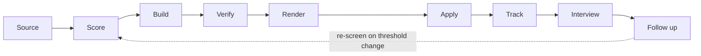

# The pipeline

Nine stages. Each one has a real tool or a real template in this repo, except where a stage is
marked as a gap.



| Stage | What ships | Status |
|---|---|---|
| Source | `tools/sourcing/sweep.py`, `harvest.py`, `li_post.py`, `probe_discover.py`, `filter_discover.py`, `fetch_jd.py`; `tools/build/capture_jd.py` | shipped (needs network) |
| Score | `templates/TARGETING.example.md`; `tools/verify/verify_liveness.py` | template only, no scoring engine |
| Build | `tools/build/packetlib.py`, `tools/build/TEMPLATE_build.py`, `tools/sourcing/build_reqs.py` | shipped |
| Verify | `tools/verify/claim_audit.py`, `verify_readback.py`, `collision_check.py`, `b9_check.py`; `tools/build/check-distinct.py` | shipped, offline |
| Render | `tools/build/render-resume_v3.sh`, `render_pdf.py`, `forbidden_names_gate.py`, `sweep-forbidden-names.sh` | shipped (needs Chrome and poppler) |
| Apply | `tools/verify/presubmit.sh`; `tools/build/book_link.py` | shipped; no form-fill driver |
| Track | `tools/verify/record_send.py`, `build_submissions.py`; `templates/QUEUE.example.md`, `templates/INTERVIEW_TRACKER.example.md` | shipped |
| Interview | `templates/call_prep.example.md` | template only |
| Follow up | none | gap (bring your own mail and calendar client) |

## Source
Board readers call public ATS APIs (Greenhouse, Ashby, Lever) and an unauthenticated LinkedIn
guest job search. `tools/build/capture_jd.py` freezes one job description into a packet folder.
See `tools/sourcing/`. These tools make live network requests.

`sweep.py` takes a plain text file of board slugs, one per line:

```text
# slugs.txt
examplecorp
globex-example
```

`python3 tools/sourcing/sweep.py slugs.txt --out-dir data/sweep` writes `boards.txt` (one line
per slug: `board`, `no-board` for a 404 on every ATS, or `error` when a request got no answer)
and `candidates.tsv` (reqs that pass your title and location screens). An `error` is not a
missing board. The tool exits 3 when any slug errored. A 404 on a vendor board does not mean the
role is dead either: check the employer's own careers domain (Lesson 3.1). Next,
`python3 tools/sourcing/fetch_jd.py data/sweep/candidates.tsv --out-dir data/sweep` fetches the
job descriptions for the candidates it has not seen before.

## Score
Score every posting against your own transparent rubric, not a platform's hidden match score
(Lesson 3.7). Copy `templates/TARGETING.example.md` and fill in your own weights and strike
conditions. **This is the one real gap in the original stack**: every batch there wrote a new
throwaway scorer instead of one reusable one. This repo ships a template for the rubric, not a
scoring engine. `tools/sourcing/fetch_jd.py` and `tools/verify/verify_liveness.py` get you the
raw data; you write (or adapt) the ranking pass.

## Build
`tools/build/packetlib.py` is the library every packet builder calls: it fills a resume and
cover-letter base, runs the pre-render guards (banned names, banned terms, em and en dashes, the
gap sentence), and writes HTML under `paths.data_root`. Copy `tools/build/TEMPLATE_build.py` to
start a builder; its `--help` lists the files it expects. A copy of `templates/resume.example.html`
works as the base resume. Every contact detail comes from the `candidate:` block of your config.
No git repository is needed.

## Verify
The strongest stage in the stack. A layered anti-fabrication gate:

- `tools/verify/claim_audit.py` audits rendered text against claim rules derived from your facts
  (`gates.claim_rules_file`), and runs its controls first.
- `tools/verify/verify_readback.py` scans a batch of packets for banned names
  (`gates.banned_names_file`), banned phrases (`gates.banned_claims_file`), and match scores with
  no evidence behind them.
- `tools/verify/collision_check.py` asks "have I already applied here?" across four trackers.
- `tools/build/check-distinct.py` measures shared six-word phrases between two cover letters.
- `tools/verify/b9_check.py` runs banned patterns (`gates.b9_rules_file`) and the same six-gram
  overlap over rendered PDF text.

Every one of them fails closed: an unreadable file or an empty list is a failure, not a pass
(Lesson 2.1). `bash scripts/demo.sh` runs them on fictional fixtures.

## Render
`tools/build/render-resume_v3.sh <file.html> <Company> [--config PATH]` renders through
`render_pdf.py` (local headless Chrome, or Playwright's bundled Chromium) and applies five
fail-closed gates:

1. the resume's `<span class="target">` names the company you render for (a cover letter must
   not carry one);
2. no remote webfont reference;
3. every font in the PDF is `render.font_family` from your config (default Carlito). Helvetica,
   Times or any other font is refused;
4. a cover letter's rendered salutation names the company;
5. no name from `gates.banned_names_file` appears in the rendered text.

The shipped templates use Carlito and pass these gates for the fictional target "Acme Corp" once
Carlito is installed. Run `python3 tools/doctor.py --stage render` first.

## Apply
`tools/verify/presubmit.sh` refuses to let a submission through until every tracker exists and
is silent and you have supplied a live mailbox-search hit count (built after a real
double-submission). A missing tracker file is a failure, not a pass; see its `--help` for the
day-one setup. `tools/build/book_link.py` lists and books interview self-schedule slots on
Calendly and Ashby pages. By default it runs a review: it fills the page, reads every control
back, prints the read-back and a confirm code, and presses nothing.
`book_link --confirm <code>` is the human's explicit go for that one booking, given after reading the read-back.
See the safety contract in `CLAUDE.md`. **Form filling itself, typing into
someone else's ATS form, is the other real gap.** See `docs/ATS_GOTCHAS.md` for what to expect
and `README.md` for why this repo does not ship a form-fill driver.

## Track
`tools/verify/record_send.py` records a confirmed send and `build_submissions.py` rebuilds a
read-only submissions view with a documented join contract: never join on req_id alone, and an
outcome beats a submitted-at date. The first recorded send shows up immediately
(`tests/test_record_send.py` checks the round trip into `presubmit.sh`). Copy
`templates/QUEUE.example.md` for the live state tracker and
`templates/INTERVIEW_TRACKER.example.md` for interviews.

## Interview
Prep from `templates/call_prep.example.md`: a scripted neutral line for any sensitive gap, named
diagnostic methods for scenario questions, and a reminder to never disparage a named past
employer. Written rejection feedback is worth asking for directly (Lesson 5.7).

## Follow up
Not shipped. The original mail and calendar watchers were built against one person's private
mail setup and are not included. The pattern: classify inbound mail by which agent it concerns
(submit, interview, build), hold a grace period after an automated ATS rejection before closing a
thread (a human can still override it), and file calendar invites. See `docs/MULTI_AGENT.md` for
how a follow-up agent talks to the others. Bring your own Gmail API, IMAP or Calendar API client.
